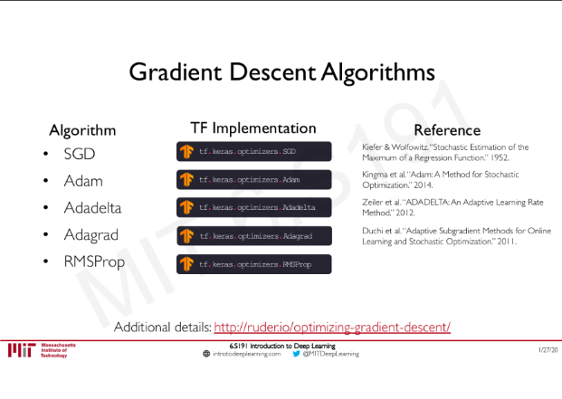
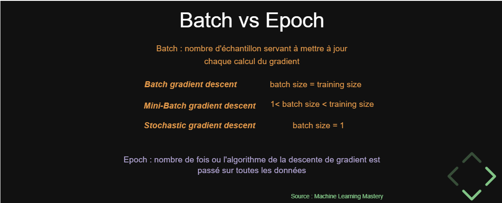
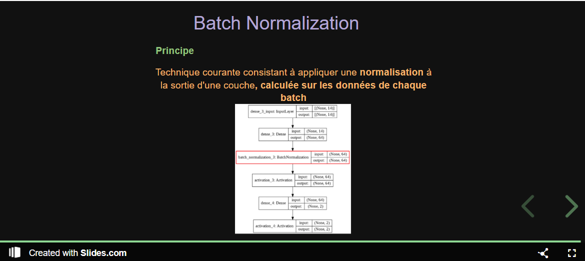

# TODO

> Tout est mis en place dans [notebooks/09_todo_tensorboard.ipynb](notebooks/09_todo_tensorboard.ipynb), suivi dans TensorBoard (`tensorboard --logdir notebooks/logs/09_todo`).

### Données
- [ ] Retirer les fuites de données : exclure `casual` et `registered` (leur somme = `cnt`), ainsi que `instant` et `dteday`
- [ ] Encoder les variables catégorielles (`season`, `mnth`, `weekday`, `weathersit`) en one-hot
- [ ] Tester un encodage cyclique (sin/cos) pour `mnth` et `weekday`
- [ ] Vérifier la normalisation des entrées (stats calculées sur le train uniquement)
- [ ] Éventuellement passer sur `hour.csv` (~17 000 lignes au lieu de 731) pour avoir plus de données

### Référence
- [ ] Garder une baseline naïve (moyenne) et une régression linéaire pour comparer chaque modèle
- [ ] Choisir une métrique commune pour tous les essais (MAE en nombre de vélos)
- [ ] Fixer les seeds (`keras.utils.set_random_seed`) pour des résultats reproductibles

### Gradient descent test
- [ ] Test different learning rates (1e-1, 1e-2, 1e-3, 1e-4)
- [ ] Test different optimizers (SGD, SGD + momentum, Adam, Adadelta, Adagrad, RMSProp)
- [ ] Test different models de tensorflow (nombre de couches, nombre de neurones, activations)
- [ ] Learning rate schedule (`ReduceLROnPlateau`, `ExponentialDecay`)
- [ ] Tracer les courbes de loss train/validation de chaque essai sur le même graphique

### Régularisation
- [ ] Dropout (taux 0.1 à 0.5)
- [ ] Early stopping (`patience`, `restore_best_weights=True`)
- [ ] Batch size 
- [ ] Batch normalization 
- [ ] Régularisation L1 / L2 sur les poids
- [ ] Combiner les techniques et comparer avec le modèle sans régularisation

### Évaluation
- [ ] Évaluer le meilleur modèle une seule fois sur le jeu de test, à la fin
- [ ] Tracer prédictions vs valeurs réelles et analyser les résidus (par saison, météo…)
- [ ] Faire un tableau récapitulatif de tous les essais (hyperparamètres + MAE validation)

### Autre
- [ ] Bien sauvegarder le modèle après l'entraînement pour ne pas le refaire à chaque fois (`model.save("modeles/xxx.keras")` + `keras.models.load_model` si le fichier existe)
- [ ] Sauvegarder aussi l'historique d'entraînement (JSON/CSV) et les paramètres de normalisation
- [ ] Sortir le fichier `.iso` de 9 Go du dossier `data/` (ou l'ajouter au `.gitignore`) avant le premier commit
- [ ] Écrire un README (objectif, dataset, comment lancer les notebooks)
